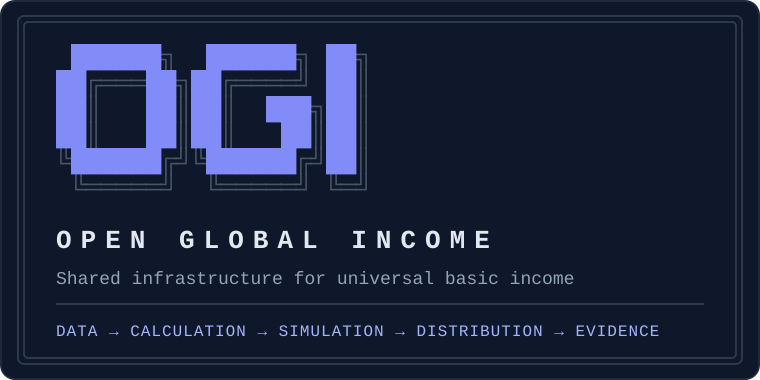

<p align="center">
  
</p>

<p align="center">
  <a href="https://github.com/richardkfm/open-global-income/actions/workflows/ci.yml"></a>
  <a href="./LICENSE"></a>
</p>

**The shared infrastructure layer for universal basic income** — the neutral, auditable protocol that any government, NGO, or DAO can build on to deliver income floors to people.

Like what OpenStreetMap did for geographic data, or what SMTP did for email: a shared standard that makes every program built on top of it cheaper, faster, and more trustworthy than if they built alone.

[How it works](#-how-it-works) · [The stack](#-the-stack) · [Who it's for](#-who-its-for) · [What it takes next](#-what-it-takes-next) · [Quickstart](#-quickstart) · [Docs](#-documentation)

---

## 🎬 How it works

<p align="center">
  
</p>

Every step of a basic income study — from "what are the facts?" to "is it working?" — is a plain API call. That means a researcher can script a whole scenario, a ministry can re-run it next year with new data, and a developer can pin it in a test. The Kenya figures above are real output of the committed data snapshot; [`src/api/readme-scenario.test.ts`](./src/api/readme-scenario.test.ts) re-derives them through the same calls on every CI run, so the picture cannot drift from the code. The evidence bars are illustrative.

Try it yourself once the server is running ([Quickstart](#-quickstart)):

```bash
curl localhost:3333/v1/income/countries/KE                 # 1 · data
curl "localhost:3333/v1/income/calc?country=KE"            # 2 · entitlement
curl -X POST localhost:3333/v1/simulate \
  -H 'content-type: application/json' \
  -d '{"country":"KE","coverage":0.2,"targetGroup":"all","durationMonths":12,"adjustments":{"floorOverride":null,"householdSize":null}}'   # 3 · cost
```

---

## 🧱 The stack

Six layers, each independently useful; the upper ones multiply the lower ones.

| Layer | Question it answers | Status |
|-------|---------------------|--------|
| 📦 **Data** | What are the economic facts? | ✅ 49 countries, 18 World Bank + 4 ILO indicators; 88 sub-national regions (KE, DE, FR, NL) — [caveats](./docs/CAPABILITIES.md#data-provenance) |
| ⚖️ **Calculation** | How much per person? How urgent is the need? | ✅ Ruleset v1 ($210 PPP/month anchor + need score), regional cost-of-living, local adequacy estimate alongside |
| 🧮 **Simulation** | What does it cost, and who pays? | ✅ Budget simulation, targeting, 8 funding mechanisms, 4-dimension impact model, policy briefs |
| 💸 **Distribution** | How does money reach people? | ✅ Non-custodial: unsigned Solana/EVM txns, M-Pesa Daraja B2C batches, SEPA ISO 20022 — OGI never moves funds or stores PII |
| 📊 **Evidence** | Is it working? Can we prove it? | 🟡 Outcome recording, recipient/control cohorts, cross-program aggregates, CSV/JSON export — no randomization or significance testing yet |
| 🤝 **Federation** | Can programs share infrastructure across borders? | ⚪ Future |

Plus a pilot dashboard, recipient registry with cross-program duplicate detection, four identity connectors, audit exports, webhooks, an admin UI, and a **public no-login site** at `/` with country fact sheets, a cost & funding calculator and copy-ready citations. Full detail: **[docs/CAPABILITIES.md](./docs/CAPABILITIES.md)**.

**Principles:** *neutral* (no blockchain or token dependency; values in PPP-USD) · *transparent* (every result carries `ruleset_version` and `data_version`) · *modular* (core domain logic has zero framework or chain imports) · *non-custodial* (prepares payment instructions, never holds funds).

---

## 👥 Who it's for

| | Use OGI today to… |
|---|---|
| 🔬 **Researchers** | Pull standardized country data, record cohort outcomes, export cross-program benchmarks |
| 🌱 **NGOs** | Compare candidate countries, model a pilot budget, enrol recipients, prepare disbursements, generate donor reports |
| 🏛️ **Governments** | Cost a program as % of GDP, design a funding mix, project poverty impact, produce an audit-grade record |
| 📰 **Journalists** | Quote per-country fact sheets with citations, share calculator scenarios by URL, download the dataset |
| ⛓️ **DAOs & donors** | Distribute on-chain against an auditable formula; track where money goes |

---

## 🧭 What it takes next

OGI can already answer *how much*, *what it costs*, *who pays* and *how it is paid*. What stands between that and basic income actually happening is mostly **trust, reach and evidence** — and each audience needs something different. This is the plan.

### 🔬 Researchers — evidence that survives peer review

| Need | Today | Next step |
|------|-------|-----------|
| Credible inputs | Committed snapshot is **manually seeded estimates**; IMF tax breakdown and tiered poverty headcounts are empty | Run the live World Bank / ILO / IMF importers into the snapshot with per-field provenance; publish versioned dataset releases with a DOI |
| Experimental design | Cohorts are recorded, not assigned | Seeded, auditable **randomized assignment** stored with the pilot; pre-registration (hash the analysis plan before data arrives) |
| Statistical rigor | Point estimates only | Power analysis, confidence intervals, difference-in-differences with standard errors; low/central/high ranges on funding and impact |
| Analysis-ready exports | CSV / JSON | Parquet and Stata/SPSS with a generated codebook |
| Outcome collection | Data fed in via API | Survey instruments delivered over the same channels as payments (SMS/USSD) |

### 🌱 NGOs — run a pilot without building infrastructure

| Need | Today | Next step |
|------|-------|-----------|
| Try before installing | Self-host only | Hosted public demo + published Docker image + one-click deploy |
| A path to follow | Narrative in [USECASE.md](./USECASE.md) | Runnable pilot template: seed script, sample recipients, step-by-step guide from site selection to donor report |
| Coverage where pilots run | Regions for KE, DE, FR, NL | Sub-national data for Tanzania, Uganda, Mozambique, Ghana, Nigeria, India |
| Shared, safe operation | Single-tenant admin | Role-based access, multi-tenancy, budget-variance alerts |
| Paying across rails | Per-rail instructions | Multi-currency reconciliation with live FX |

### 🏛️ Governments — a costing they can defend in parliament

| Need | Today | Next step |
|------|-------|-----------|
| A scenario that stays fixed once cited | Saved simulations record their ruleset and data version but are not signed and can be deleted | **Scenario versioning** — signed, immutable snapshots of the inputs, ruleset and data version |
| Realistic rollout planning | One-shot simulation | Phased multi-year rollout and household-size reporting ([Income Floor Phase 3](./INCOME_FLOOR_PROPOSED_ANSWERS.md)) |
| Authoritative enrollment | Offline format/checksum validation | One real verifier (e.g. MOSIP IDA) behind the national-ID connector |
| Procurement readiness | Code + docs | Published threat model, data-protection impact assessment template, accessibility audit |
| National-scale programs | One simulation per pilot | Multi-region pilot orchestration and roll-up |

### 📰 Journalists & advocates — numbers you can quote safely

| Need | Today | Next step |
|------|-------|-----------|
| Figures that are current | Seeded snapshot (see researchers) | Live data with a visible "as of" date and source on every number |
| Easy reuse | Fact sheets, shareable URLs, CSV | Embeddable charts and fact-sheet cards, social share images |
| Answers to common objections | Methodology page | Plain-language explainers (inflation, work incentives, fraud) linked to the evidence base |
| Reach beyond English | i18n scaffolding on the public site | Swahili, French, Portuguese and Hindi translations |

### Sequencing

| When | Work | Unblocks |
|------|------|----------|
| **Now** (≈ 3 months) | Live data refresh with provenance · hosted demo + Docker image · clear lint/format debt and gate it in CI · "good first issue" tasks for regional data curation | Every audience — nothing else is quotable until the data is live |
| **Next** (≈ 3–9 months) | Randomization, power analysis and confidence intervals · uncertainty ranges · scenario versioning · RBAC/multi-tenancy · one authoritative identity verifier · 5 more countries' regions | Research-grade pilots and institutional deployment |
| **Later** | Survey delivery · solidarity pool for donors · federation (cross-program interop, portability, open evidence base) · multi-stakeholder governance | The protocol vision |

The detailed gap analysis is in [GOVERNMENT_READINESS.md](./GOVERNMENT_READINESS.md); completed phases are documented in [ROADMAP.md](./ROADMAP.md).

**How you can help:** researchers — review the [methodology](./IMPACT_METHODOLOGY.md) and propose ruleset changes through [governance](./GOVERNANCE.md) · NGOs and governments — become a pilot or data partner · journalists — use the fact sheets and report anything that looks wrong · developers — see [CONTRIBUTING.md](./CONTRIBUTING.md).

---

## 🚀 Quickstart

```bash
git clone https://github.com/richardkfm/open-global-income.git
cd open-global-income
npm install
npm run dev        # API + public site + admin on http://localhost:3333
npm test           # 734 tests across 40 suites
```

Swagger UI at `/docs`, public site at `/`, admin UI at `/admin`. Docker: `cp .env.example .env` (set `ADMIN_USERNAME` / `ADMIN_PASSWORD`), then `docker compose up --build`.

> **Before citing any figure:** the committed `countries.json` holds manually seeded estimates. Run `npm run data:update` for live World Bank / ILO data. See [Data provenance](./docs/CAPABILITIES.md#data-provenance).

Configuration, every endpoint, auth, webhooks, SDK and database: **[docs/DEVELOPER_GUIDE.md](./docs/DEVELOPER_GUIDE.md)**.

---

## 📚 Documentation

| Document | For |
|----------|-----|
| [docs/CAPABILITIES.md](./docs/CAPABILITIES.md) | Everything built, data provenance, rulesets, funding & impact models, public site, admin UI, providers, release history |
| [docs/DEVELOPER_GUIDE.md](./docs/DEVELOPER_GUIDE.md) | Setup, environment variables, full API reference, auth, webhooks, SDK, database, architecture |
| [ARCHITECTURE.md](./ARCHITECTURE.md) | Dependency rules and design decisions |
| [RULESET_V1.md](./RULESET_V1.md) · [IMPACT_METHODOLOGY.md](./IMPACT_METHODOLOGY.md) | The entitlement formula and the impact model, with every assumption |
| [INCOME_FLOOR_PROPOSED_ANSWERS.md](./INCOME_FLOOR_PROPOSED_ANSWERS.md) | Why $210 PPP, and how local adequacy is reported alongside it |
| [GOVERNMENT_READINESS.md](./GOVERNMENT_READINESS.md) · [USECASE.md](./USECASE.md) | What a real program can rely on today, and a worked use case |
| [ROADMAP.md](./ROADMAP.md) · [CHANGELOG.md](./CHANGELOG.md) | Phase-by-phase build history and version notes |
| [CONTRIBUTING.md](./CONTRIBUTING.md) · [GOVERNANCE.md](./GOVERNANCE.md) | How to contribute and how decisions are made |

---

## 📄 License

[MIT](./LICENSE)
